# Prompt Homepage
## Prompt 1
```text
Triển khai homepage cho `pos-zalo-mini-app-fe/apps/zma-0001`.

Link Figma:
- https://www.figma.com/design/1B8pdJieC9eZW07dA0z46S/Zma-0001---Th%E1%BB%9Di-trang?node-id=61-148141&t=lPs25FlloMRGNlLU-0

Yêu cầu với Figma:
- Figma là chuẩn UI duy nhất.
- Những phần như status bar giả: thời gian, cột wifi... và mini app control giả bên phải sẽ bỏ qua.
- Đọc node Figma để lấy layout, spacing, typography, màu sắc, image/icon.
- Dựng UI giống Figma trước, dùng mock/fallback data nếu cần.
- Sau khi UI đúng Figma mới ghép dữ liệu thật từ service/model/API.

Giao diện:
- Header, search, hero banner, OA block, danh mục, Flash Sales, 2 block tin tức và bottom navigation theo Figma.
- Không tự ý thêm/bỏ section hoặc đổi visual khác Figma.

Logic:
- Sửa header/footer global theo header/nav của Figma.
- Load banner, danh mục, sản phẩm, tin tức.
- API lỗi hoặc rỗng thì giữ fallback data để UI không vỡ.
- Điều hướng theo route hiện có: search, category, product detail, news, cart, user.
- Nếu thiếu logic, tham khảo homepage `zma-0002`.

Docs API:
- `../webapp-be-fe-docs/docs/docs-api/webapptpl`
- Đọc docs API trước khi ghép dữ liệu.
- Nếu path không tồn tại, dùng service/model/endpoint hiện có trong repo và ghi chú lại.

Output/lưu ý:
- Chỉ sửa phạm vi homepage `apps/zma-0001`.
- Không revert thay đổi không liên quan.
- Chạy build/kiểm tra sau khi sửa.
- Báo rõ phần dùng fallback và phần đã ghép dữ liệu thật.
```

## Kết quả sau prompt 1

Ảnh kết quả:

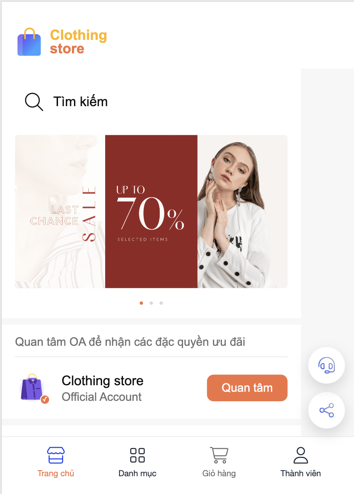
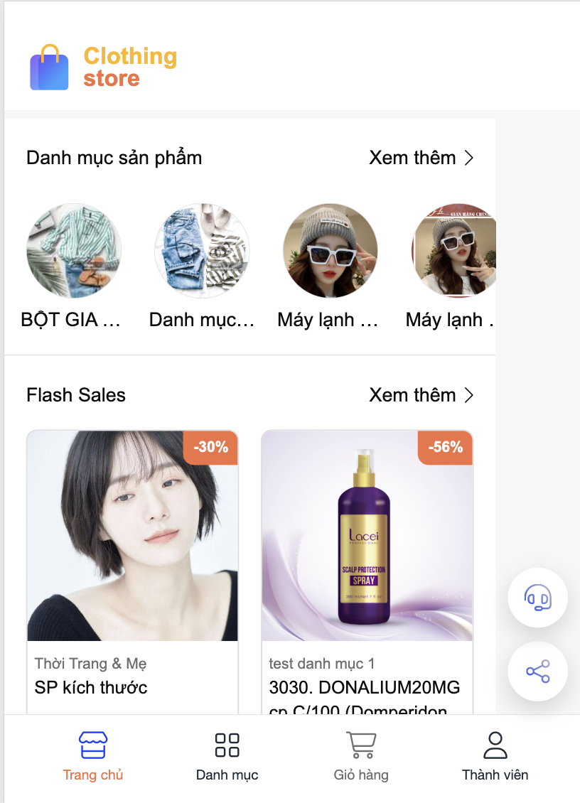
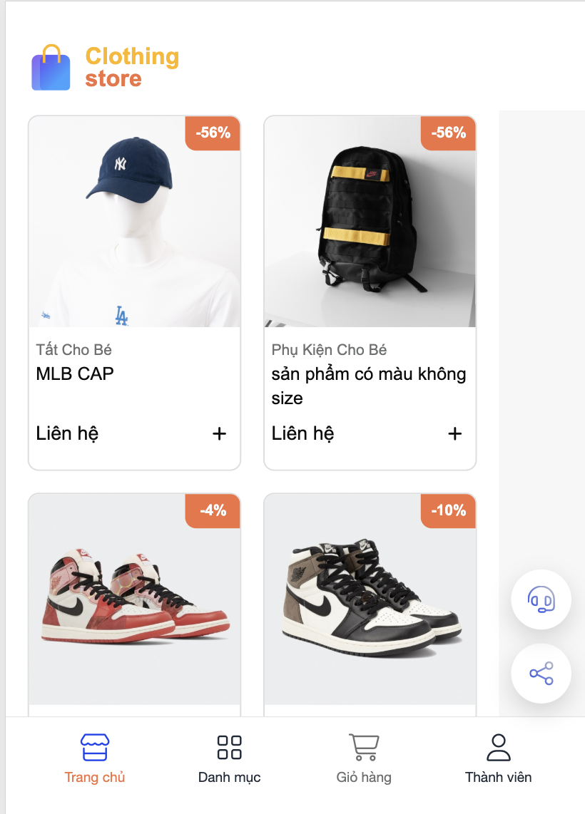
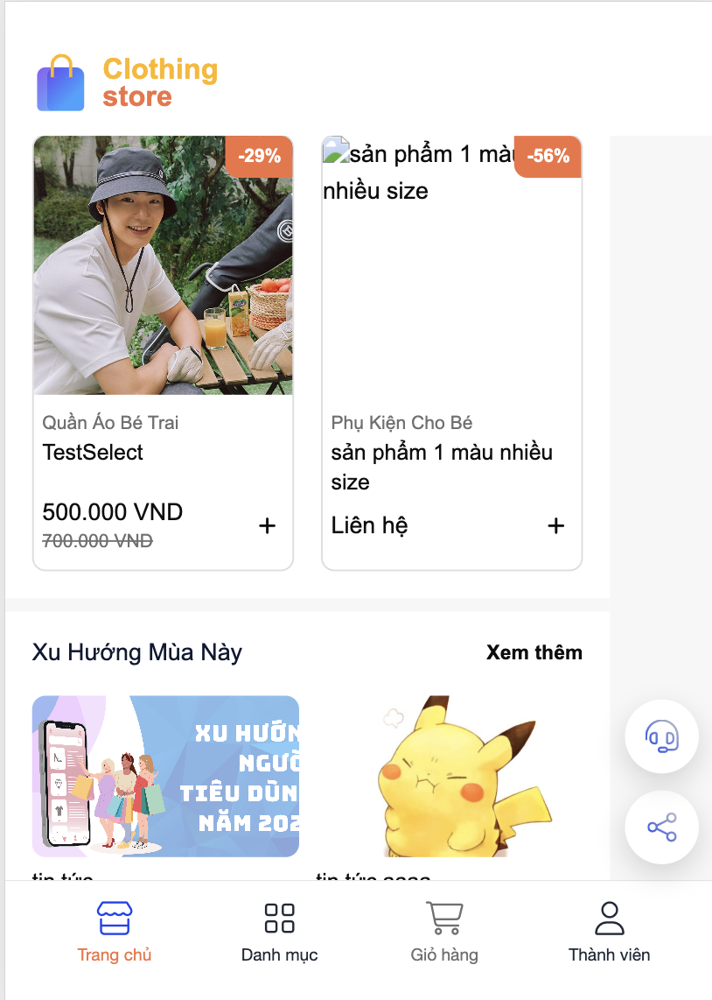
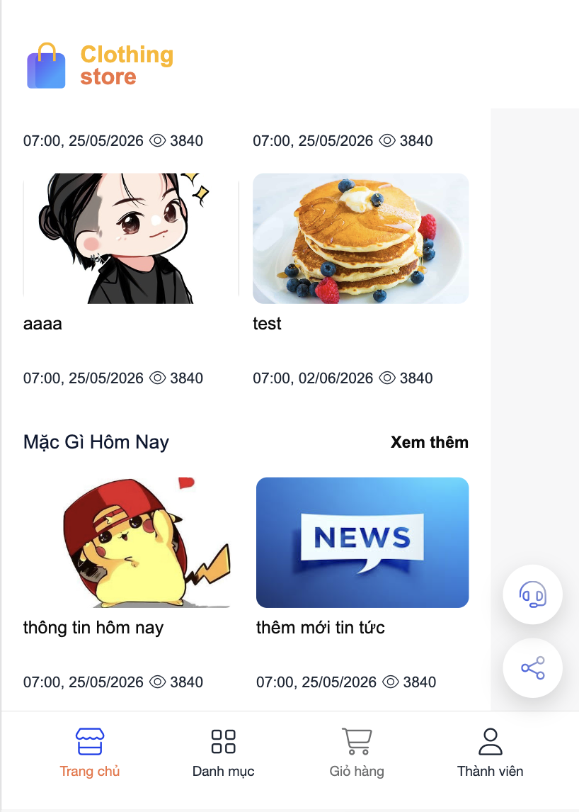

```text

Vấn đề thấy trên screenshot:
- Các phần cần slide như banner, danh mục sản phẩm cần dùng 'app-universal-slide'.
- Layout bị lệch ngang: phần nội dung chỉ chiếm bên trái, còn dư mảng xám bên phải.
- FAB support/share vẫn hiện đè lên UI, không có trong Figma.
- Dữ liệu thật làm UI lệch Figma: category/product/news không còn đồng nhất mock fashion.
- Product card bị cao/lệch text, có sản phẩm "Liên hệ", ảnh lỗi hoặc ảnh không đúng tỉ lệ.
- News block bị lệch spacing/order, meta date/view có lúc nằm phía trên ảnh.
- Bottom navigation đang lớn hơn Figma và icon/text chưa đúng màu/kích thước.
- Không được khóa viewport/home shell.
```

## Prompt 2

```text
Các lỗi cần sửa:
- Các phần cần slide như banner, danh mục sản phẩm cần dùng 'app-universal-slide'.
- Không được khóa viewport/home shell.
- FAB support/share đang hiện đè UI, Figma không có. Ẩn FAB ở homepage.
- Header/logo đang quá lớn và spacing chưa giống Figma. Chỉnh theo Figma, vẫn bỏ status bar giả và mini app control giả nếu prompt trước đã yêu cầu bỏ.
- Category dùng dữ liệu thật nhưng phải giữ layout Figma: item tròn 70px, label 1 dòng, không làm vỡ hàng.
- Flash Sales phải giữ card 2 cột theo Figma:
  - ảnh vuông cố định;
  - card cao ổn định;
  - category 1 dòng;
  - tên sản phẩm clamp 2 dòng;
  - giá không đẩy layout;
  - ảnh lỗi thì dùng fallback;
  - nếu giá là "Liên hệ" vẫn không phá card.
- News block phải đúng Figma:
  - ảnh trên, title dưới, meta date/view dưới cùng;
  - không để meta nằm phía trên ảnh;
  - clamp title để card đều nhau.
- Bottom nav dùng footer global nhưng phải giống Figma: 4 tab, icon/text nhỏ hơn hiện tại, active màu cam, không shadow thừa.

Logic/data:
- Vẫn load banner, category, product, news từ service/model hiện có.
- Nếu dữ liệu thật làm phá visual Figma, map có kiểm soát hoặc dùng fallback/mock cho phần ảnh/text hiển thị.
- Đọc docs API tại `../webapp-be-fe-docs/docs/docs-api/webapptpl` nếu cần xác nhận response.

Kiểm tra bắt buộc:
- Báo rõ đã fix lỗi nào từ 5 ảnh prompt 1, lỗi nào còn lại.
```

## Kết quả sau prompt 2

Ảnh kết quả:

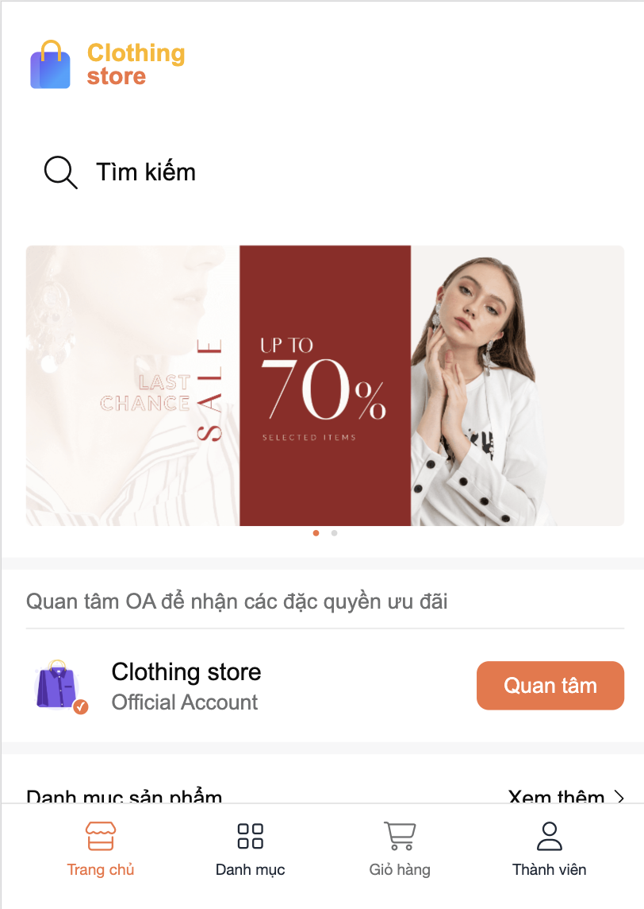

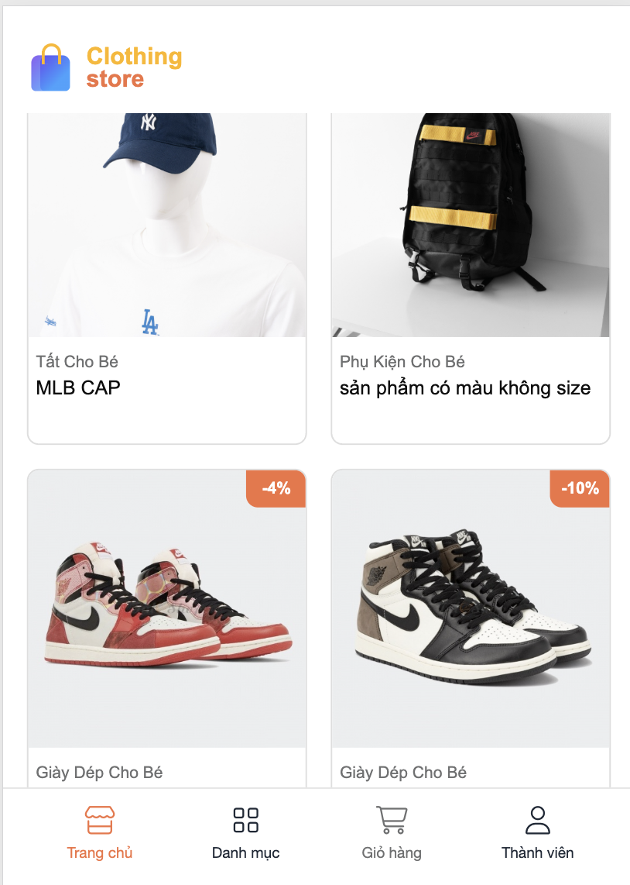
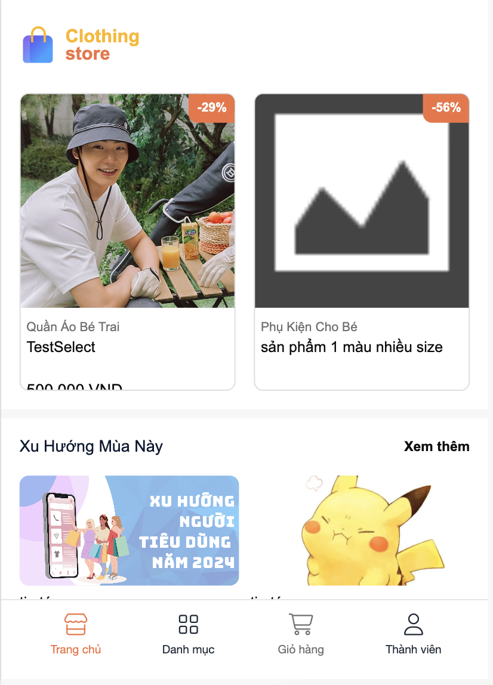
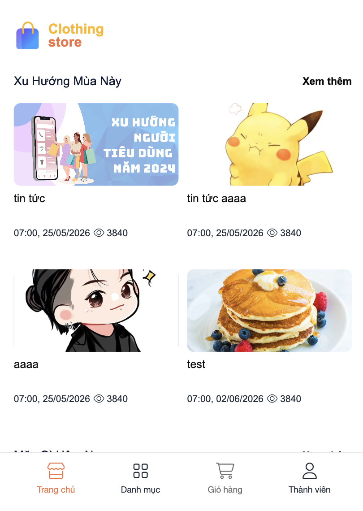

```text

Kết quả prompt 2:
- Banner và danh mục đã đổi sang `app-universal-slide`.
- FAB support/share đã được ẩn ở homepage.
- Header/logo đã nhỏ hơn prompt 1 và bỏ mini app control giả.
- Product/news đã có clamp/fallback cơ bản.
- Bottom nav đã theo 4 tab.

Lỗi còn lại sau prompt 2:
- Slide danh mục sản phẩm đang không kéo được.
- Phần giá sản phẩm đang bị ẩn bớt một phần và bị chìm xuống dưới card.
- Phần tin tức bên dưới không được fix cứng tiêu đề như "Xu Hướng Mùa Này", "Mặc Gì Hôm Nay".
- Tin tức phải lấy theo danh mục tin tức.
- Lượt xem tin tức nếu chưa có thì để `0`, không fallback `3840`.
- Ngày đăng tin tức dùng format Angular date: `dd/MM/yyyy`.
```

## Prompt 3

```text
Tiếp tục sửa homepage template `zma-0001`

Các lỗi cần sửa:
- Slide danh mục sản phẩm đang không kéo được
- Giá sản phẩm đang bị ẩn bớt và chìm xuống dưới:
  - chỉnh lại product card height/content layout;
  - ảnh vuông cố định;
  - category 1 dòng;
  - tên clamp 2 dòng;
  - price block luôn nằm trong card, không bị cắt;
  - trường hợp `Liên hệ` vẫn nằm đúng vị trí.
- Tin tức:
  - Không fix cứng title section như "Xu Hướng Mùa Này", "Mặc Gì Hôm Nay".
  - Load danh mục tin tức từ service/model hiện có.
  - Mỗi section tin tức lấy tên section theo danh mục tin tức.
  - Bài viết load theo categoryId tương ứng nếu service/API hỗ trợ.
  - `hits` nếu null/undefined thì hiển thị `0`.
  - Ngày đăng dùng format `date:'dd/MM/yyyy'`, không hiển thị giờ.
  - Không dùng fallback lượt view `3840`.

Logic/data:
- Đọc docs API tại `../webapp-be-fe-docs/docs/docs-api/webapptpl/article`.
- Ưu tiên service `NewsCategoryCacheService` hiện có; nếu thiếu method thì mở rộng tối thiểu, đúng pattern repo.
- Không phá các phần đã fix ở prompt 2: FAB ẩn, header/footer skin, banner slide, product fallback image.

Kiểm tra bắt buộc:
- Báo rõ đã sửa lỗi nào từ ảnh prompt 2, lỗi nào còn lại.
```

## Kết quả sau prompt 3

Ảnh kết quả:


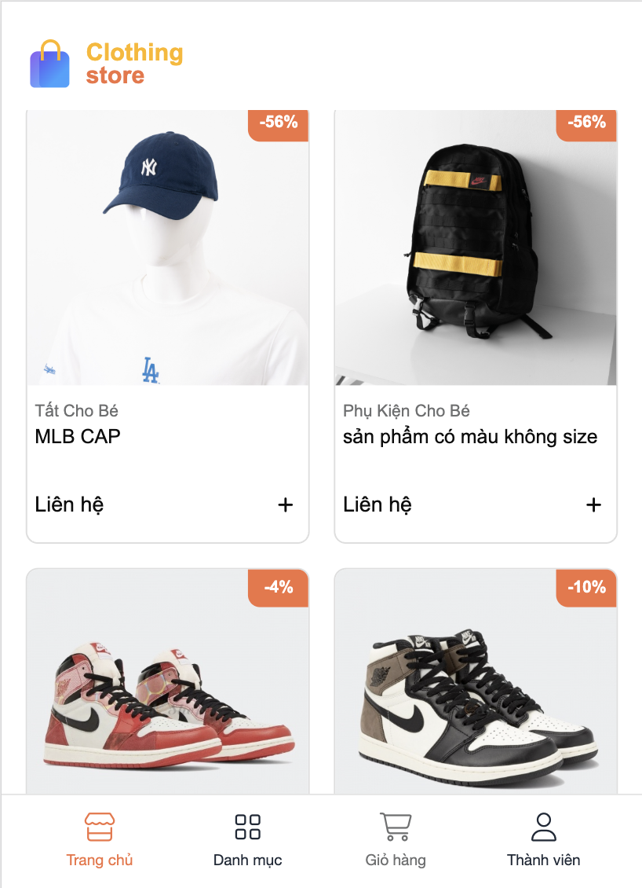
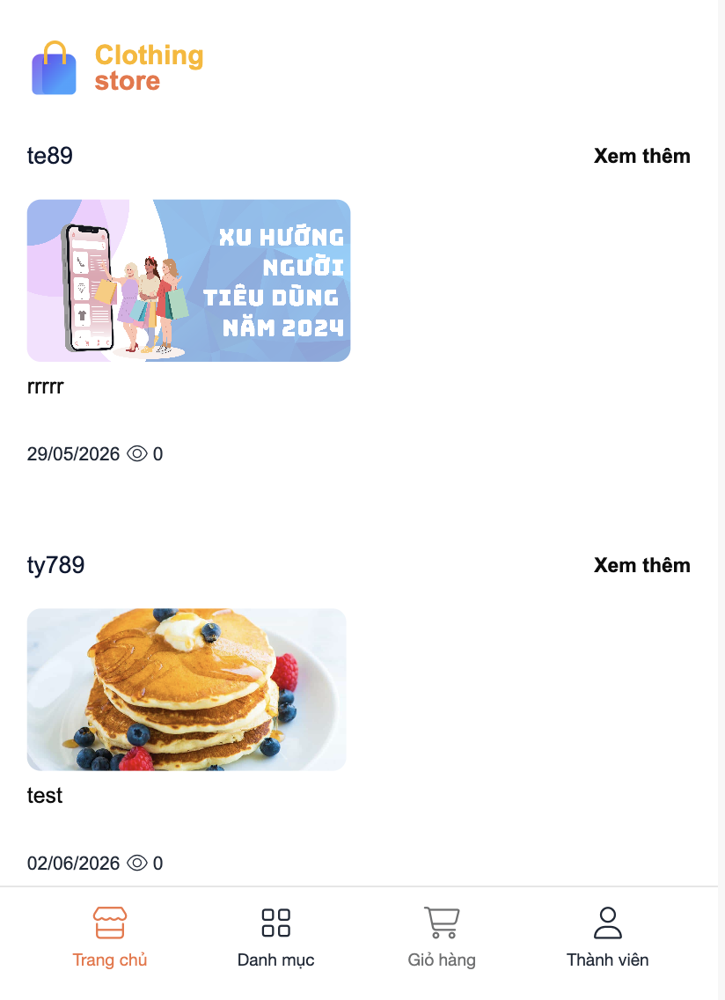

```text

Kết quả prompt 3:
- Slide danh mục sản phẩm đã xử lý lại để có thể kéo ngang.
- Product card/price block đã được chỉnh để giảm lỗi giá bị cắt.
- Tin tức đã chuyển hướng lấy theo danh mục tin tức thay vì fix cứng section title.
- Lượt xem tin tức dùng `0` khi thiếu dữ liệu.
- Ngày đăng tin tức dùng format `dd/MM/yyyy`.

Lỗi còn lại sau prompt 3:
- Background phần tìm kiếm đang sai màu so với Figma.
- Nút thêm nhanh ở item sản phẩm đang sai style so với Figma.
```

## Prompt 4

```text
Tiếp tục sửa homepage template `zma-0001`.

Các lỗi cần sửa:
- Background phần tìm kiếm đang sai màu:
  - đối chiếu Figma node homepage;
- Nút thêm nhanh ở item sản phẩm đang sai style so với Figma:
  - nút add phải đúng icon, màu, kích thước, vị trí và trạng thái theo Figma;
Kiểm tra bắt buộc:
- Chạy build development cho `zma-0001`.
- Báo rõ đã sửa search background và nút thêm nhanh như thế nào.
```

## Kết quả sau prompt 4

Ảnh kết quả:

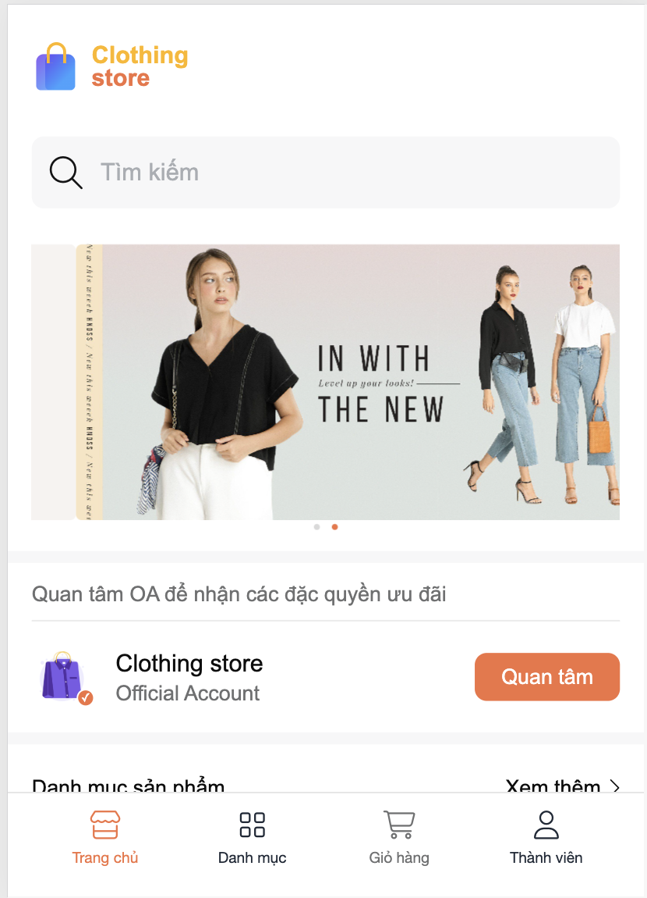

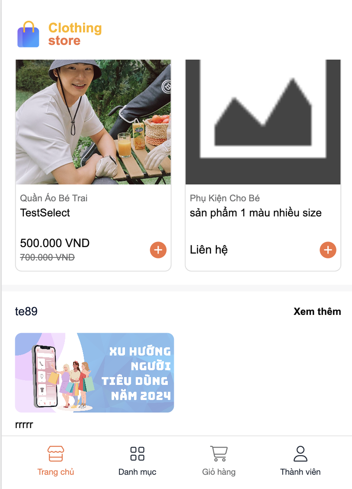


```text
Kết quả prompt 4:
- Đã sửa background phần tìm kiếm.
- Đã sửa style nút thêm nhanh ở item sản phẩm theo Figma.
```

