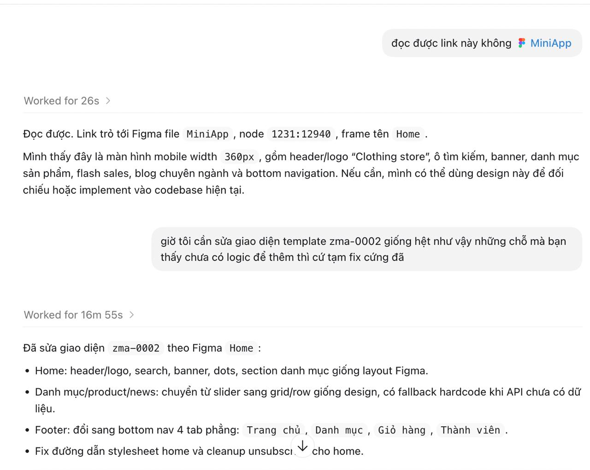
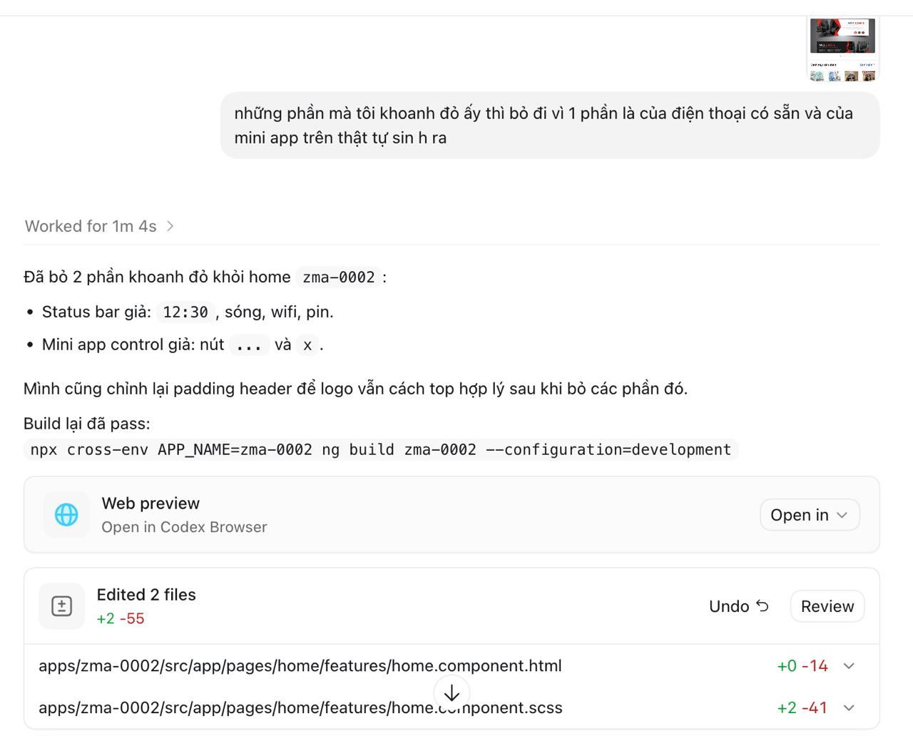
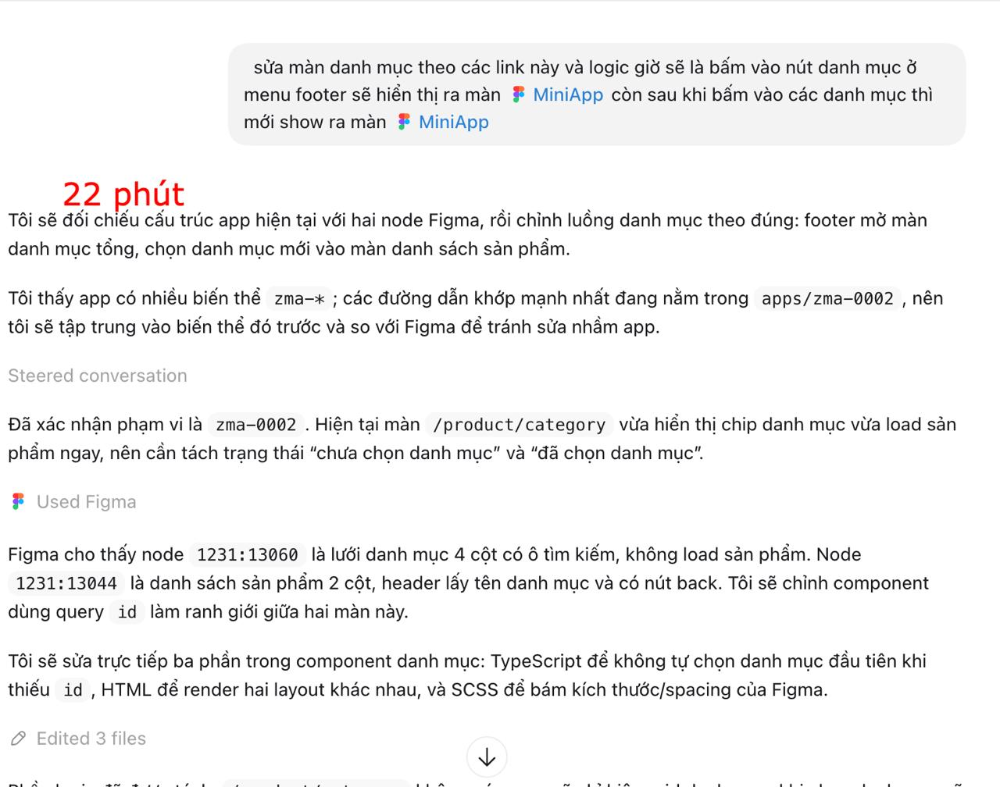
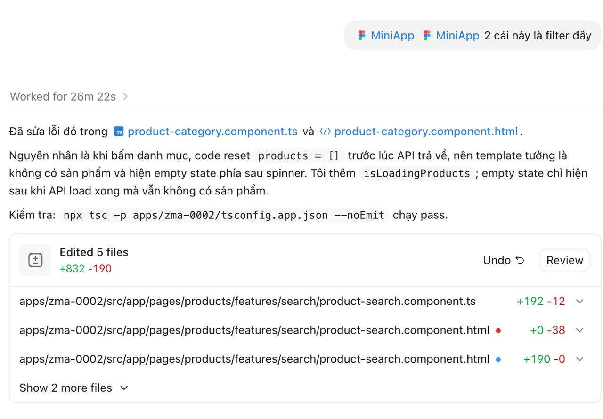
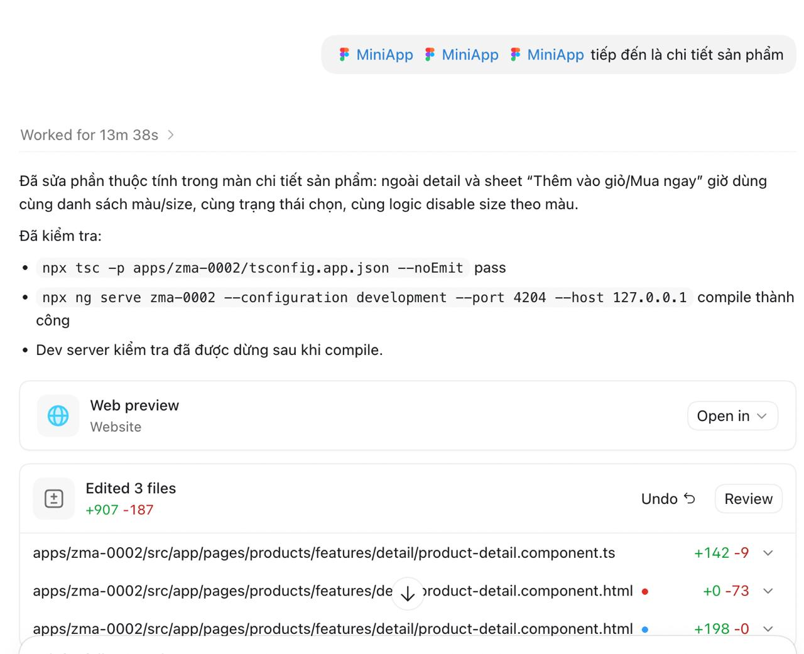
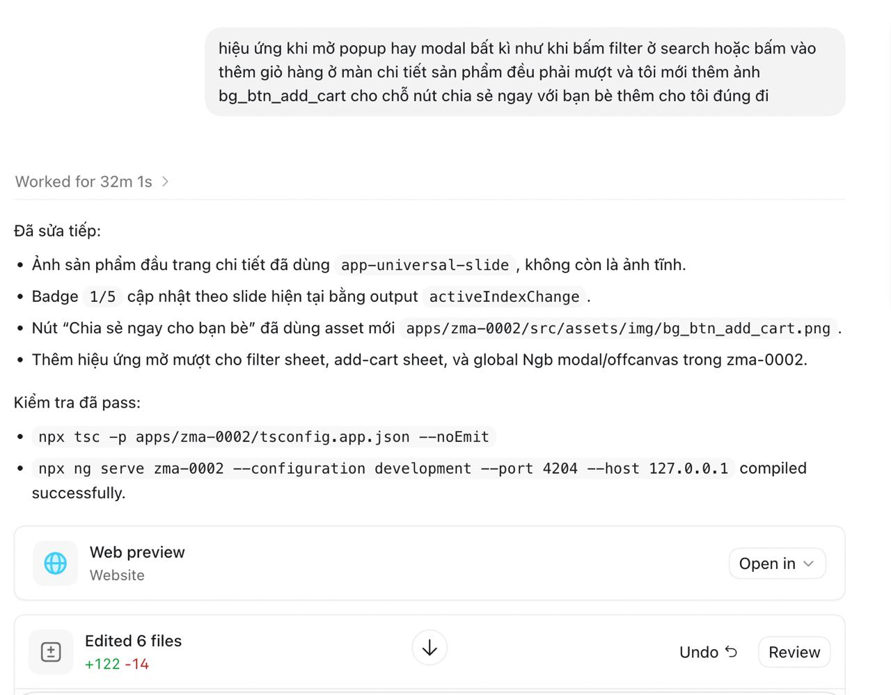
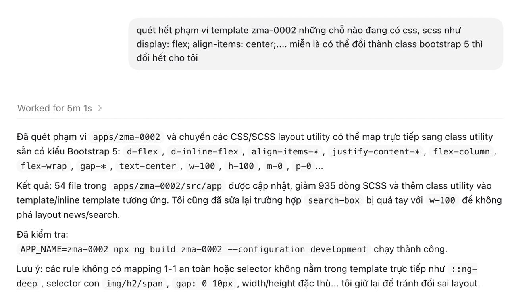
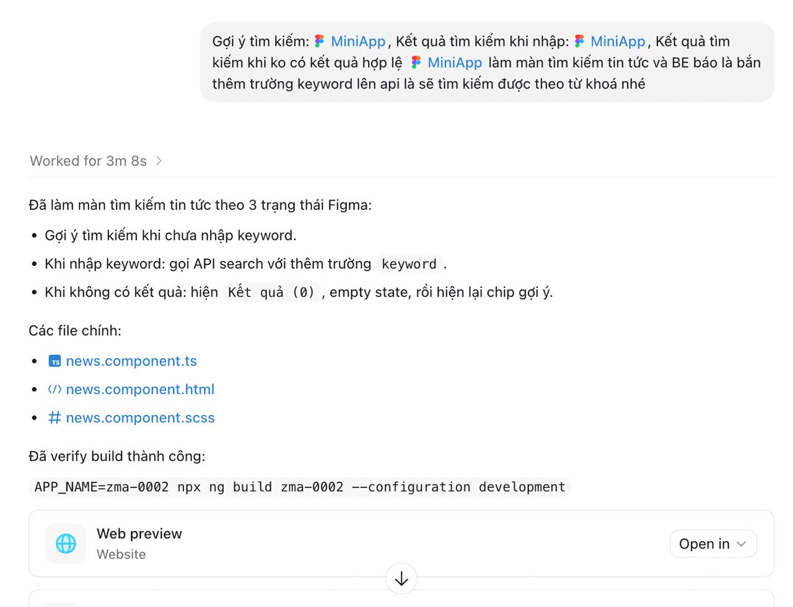
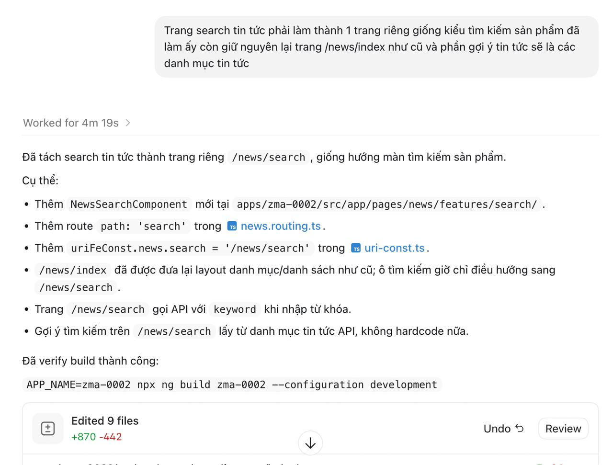

# Tổng hợp prompt Figma

Tài liệu này tổng hợp các prompt đã dùng khi triển khai giao diện từ Figma cho template `zma-0002`, kèm ảnh kết quả và thời gian hoàn thành.

## Prompt 01: Sửa Home theo Figma

**Ảnh kết quả**



**Nội dung prompt**

```text
giờ tôi cần sửa giao diện template zma-0002 giống hệt như vậy những chỗ mà bạn thấy chưa có logic để thêm thì cứ tạm fix cứng đã
```

**Thời gian hoàn thành**

```text
16m 55s
```

---

## Prompt 02: Bỏ status bar và mini app control giả

**Ảnh kết quả**



**Nội dung prompt**

```text
những phần mà tôi khoanh đỏ ấy thì bỏ đi vì 1 phần là của điện thoại có sẵn và của mini app trên thật tự sinh ra
```

**Thời gian hoàn thành**

```text
1m 4s
```

---

## Prompt 03: Sửa luồng danh mục

**Ảnh kết quả**



**Nội dung prompt**

```text
sửa màn danh mục theo các link này và logic giờ sẽ là bấm vào nút danh mục ở menu footer sẽ hiển thị ra màn, còn sau khi bấm vào các danh mục thì mới show ra màn
```

**Thời gian hoàn thành**

```text
22 phút
```

---

## Prompt 04: Sửa filter và trạng thái loading sản phẩm

**Ảnh kết quả**



**Nội dung prompt**

```text
2 cái này là filter đấy
```

**Thời gian hoàn thành**

```text
26m 22s
```

---

## Prompt 05: Sửa thuộc tính chi tiết sản phẩm

**Ảnh kết quả**



**Nội dung prompt**

```text
tiếp đến là chi tiết sản phẩm
```

**Thời gian hoàn thành**

```text
13m 38s
```

---

## Prompt 06: Thêm hiệu ứng modal và ảnh nút chia sẻ

**Ảnh kết quả**



**Nội dung prompt**

```text
hiệu ứng khi mở popup hay modal bất kì như khi bấm filter ở search hoặc bấm vào thêm giỏ hàng ở màn chi tiết sản phẩm đều phải mượt và tôi mới thêm ảnh bg_btn_add_cart cho chỗ nút chia sẻ ngay với bạn bè thêm cho tôi đúng đi
```

**Thời gian hoàn thành**

```text
32m 1s
```

---

## Prompt 07: Chuyển layout SCSS sang Bootstrap 5 utilities

**Ảnh kết quả**



**Nội dung prompt**

```text
quét hết phạm vi template zma-0002 những chỗ nào đang có css, scss như display: flex; align-items: center;.... miễn là có thể đổi thành class bootstrap 5 thì đổi hết cho tôi
```

**Thời gian hoàn thành**

```text
5m 1s
```

---

## Prompt 08: Làm màn tìm kiếm tin tức theo trạng thái Figma

**Ảnh kết quả**



**Nội dung prompt**

```text
Gợi ý tìm kiếm; Kết quả tìm kiếm khi nhập; Kết quả tìm kiếm khi ko có kết quả hợp lệ làm màn tìm kiếm tin tức và BE báo là bắn thêm trường keyword lên api là sẽ tìm kiếm được theo từ khoá nhé
```

**Thời gian hoàn thành**

```text
3m 8s
```

---

## Prompt 09: Tách search tin tức thành trang riêng

**Ảnh kết quả**



**Nội dung prompt**

```text
Trang search tin tức phải làm thành 1 trang riêng giống kiểu tìm kiếm sản phẩm đã làm ấy còn giữ nguyên lại trang /news/index như cũ và phần gợi ý tin tức sẽ là các danh mục tin tức
```

**Thời gian hoàn thành**

```text
4m 19s
```
