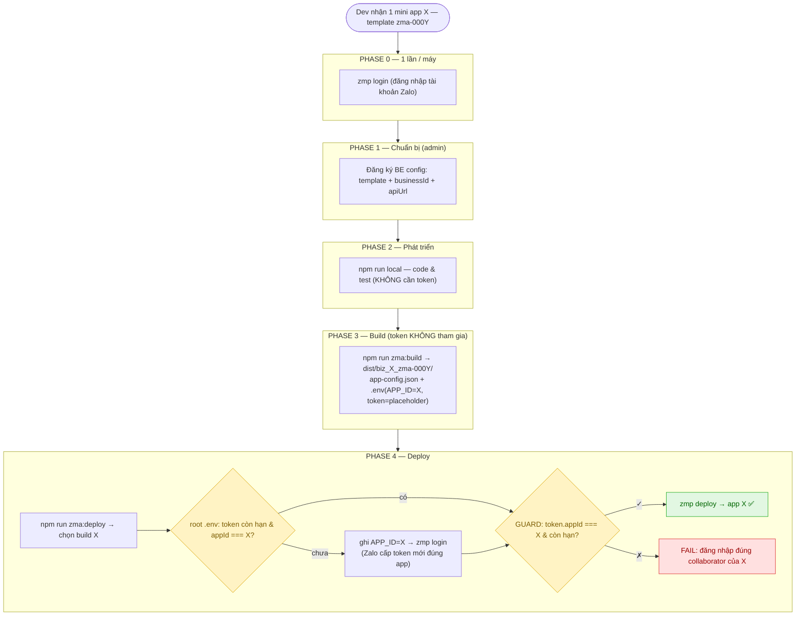
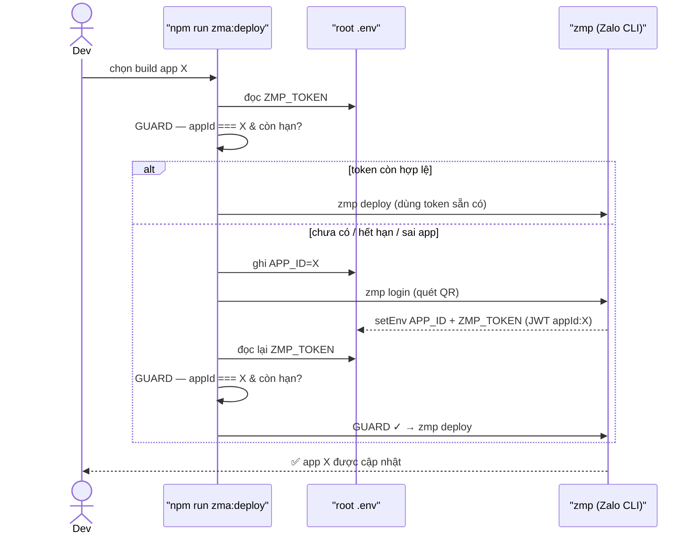
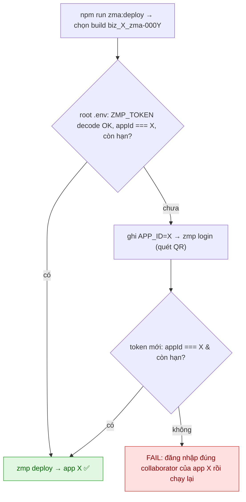
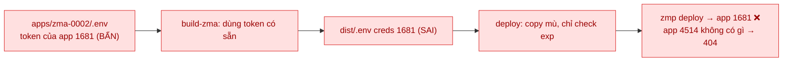

# ZMA Build & Deploy — Nghiệp vụ & Cách hoạt động

> File này giải thích **cơ chế** đằng sau build/deploy Zalo Mini App (ZMA).
> Nếu chỉ cần các bước thao tác, xem **[`docs/zma-build-deploy-guide.md`](./zma-build-deploy-guide.md)**.

---

## 1. Mô hình khái niệm

| Khái niệm | Ý nghĩa | Phạm vi |
|---|---|---|
| **Template** (`apps/zma-000X/`) | 1 codebase Angular dùng chung | Build ra **nhiều** mini app khác nhau |
| **Mini App** (`miniAppId`) | 1 app cụ thể trên Zalo | Mỗi app có `businessId`, OA, token riêng |
| **ZMP_TOKEN** | JWT cấp quyền deploy | **Per-mini-app** (claim `appId` khoá cứng vào 1 app) |

---

## 2. Hai sự thật nền tảng (đã xác minh từ source)

### 2.1. Bundle KHÔNG dùng `APP_ID` / `ZMP_TOKEN`

`environment.prod.ts` (cả 6 template giống nhau) chỉ chứa 4 placeholder:

```
__API_URL__   __OA_ID__   __WEB_APP_ID__   __ZALO_BASE_HREF__
```

`miniAppId` chỉ xuất hiện **gián tiếp** trong `__ZALO_BASE_HREF__ = /zapps/{miniAppId}/`.
`webpack.extra.js` chỉ đọc `APP_NAME`. ⇒ **`APP_ID` và `ZMP_TOKEN` không hề đi vào bundle** — chúng chỉ là metadata cho lệnh `zmp`.

### 2.2. `zmp` đọc `.env` theo thư mục đang chạy (CWD)

Từ `zmp-cli/config/index.js`:

```js
'root_env': () => process.cwd() + '/.env'
'env': { 'appId': 'APP_ID', 'token': 'ZMP_TOKEN' }
```

⇒ `zmp deploy` (chạy ở **root**) đọc `root/.env`, lấy `APP_ID` → app đích, `ZMP_TOKEN` → auth.
⇒ Thư mục template Angular **không liên quan** tới token. `cd apps/zma-000X && zmp init` chỉ là thói quen khiến token rơi vào `.env` template — đây chính là nguồn gốc lỗi đẩy nhầm app (xem Phụ lục B).

---

## 3. Vai trò các file

| File | Vai trò | Ai đọc |
|---|---|---|
| `apps/zma-000X/src/environments/environment.prod.ts` | Placeholder cho bundle production | `ng build` |
| `apps/zma-000X/src/environments/environment.ts` | Config local dev (auto-gen bởi `npm run local`) | `ng serve` |
| `apps/zma-000X/app-config.json` | App-config gốc (title, màu header…) | Build (base) |
| `apps/zma-000X/.env` | **Luôn là placeholder** `APP_ID=__MINI_APP_ID__` / `ZMP_TOKEN=__ZMP_TOKEN__` | build-zma (fill tạm rồi restore) |
| `/.env` (root) | `APP_ID` + `ZMP_TOKEN` do `zmp login` ghi; deploy đọc lại để GUARD rồi `zmp deploy` | zmp login, deploy-zma, zmp deploy |
| `dist/{businessId}_{miniAppId}_{template}/app-config.json` | App-config deploy (kèm listCSS/JS) | `zmp deploy` |
| `dist/{businessId}_{miniAppId}_{template}/.env` | `APP_ID={miniAppId}`, `ZMP_TOKEN=__ZMP_TOKEN__` | (tham chiếu; deploy lấy miniAppId từ manifest) |
| `dist/build-manifest.json` | Lịch sử build mọi app | deploy-zma, các script list |

---

## 4. Luồng Local dev — `npm run local`

```
chọn template + mini app  →  ghi environment.ts (webAppId, apiUrl, OAId, zaloBaseHref='/')  →  ng serve
```

- **Không** đụng `.env`, **không** cần token.
- `environment.ts` được gitignore (auto-generated).

---

## 5. Luồng Build — `npm run zma:build`

```
fetch danh sách app từ API  →  chọn  →  với mỗi app: build-zma.js
```

`build-zma.js` cho mỗi app:
1. Resolve config từ BE API (theo `webAppId`). API là nguồn duy nhất.
2. Fill placeholder vào `environment.prod.ts` + `app-config.json` + `.env`:
   - `__ZALO_BASE_HREF__` → `/zapps/{miniAppId}/`
   - `__API_URL__`, `__WEB_APP_ID__`, `__OA_ID__`, `__APP_TITLE__`, `__HEADER_*__`
   - `.env`: `APP_ID=__MINI_APP_ID__` → `{miniAppId}` (suy từ build target, không nhập nhằng)
3. `ng build {template} --configuration=production`.
4. Rename `dist/{template}/` → `dist/{businessId}_{miniAppId}_{template}/`.
5. Sinh `app-config.json` deploy (scan listCSS/listSyncJS/listAsyncJS) + `.env` vào dist.
6. Ghi `dist/build-manifest.json`.
7. **Luôn restore** file template về placeholder.

> **Token KHÔNG tham gia bước build.** Dist `.env` để `ZMP_TOKEN=__ZMP_TOKEN__` (placeholder), điền ở bước deploy. Root `app-config.json`/`.env` không bị đụng.

---

## 6. Luồng Deploy — `npm run zma:deploy`

```
đọc build-manifest  →  chọn build (đã biết miniAppId)  →  token trong root .env còn hợp lệ cho app?
   →  nếu chưa: ghi APP_ID=miniAppId + zmp login (Zalo cấp token mới đúng app)
   →  GUARD  →  chuẩn hoá root .env (APP_ID + token)  →  copy app-config.json  →  zmp deploy
```

**Token lấy ở đâu:** `zmp login` xác thực tài khoản Zalo rồi **ghi thẳng `APP_ID` + `ZMP_TOKEN` vào root `.env`** (đã xác minh trong `zmp-cli/login/index.js`: `setEnv('APP_ID', …)` + `setEnv('ZMP_TOKEN', jwt)`). Vì ghi `APP_ID` **trước**, `zmp login` bỏ qua prompt "Mini App ID" và mint token đúng app. Token còn hạn → lần deploy sau **bỏ qua** bước login.

**GUARD (chốt an toàn, đặt ngay trước hành động nguy hiểm)** — token trong root `.env` phải:
- Decode JWT thành công.
- `payload.appId === miniAppId` (đúng app đã chọn).
- Còn hạn (`exp`).

Sai bất kỳ điều kiện nào → **dừng deploy** kèm hướng dẫn sửa. Nhờ guard, **không thể** đẩy nhầm bundle của app này lên app khác.

---

## 7. Cơ chế an toàn (tóm tắt)

| Lớp | Bảo vệ |
|---|---|
| Template `.env` = placeholder | Token không bao giờ nằm trong codebase dùng chung ⇒ không rò |
| Token do `zmp login` cấp lúc deploy | Không lưu token lâu dài trong repo; mỗi lần lấy token tươi đúng app |
| `APP_ID` ghi trước khi login | `zmp login` mint token đúng `miniAppId` đã chọn (bỏ qua prompt app id) |
| **GUARD `appId === miniAppId`** | Dù login nhầm / đọc nhầm, vẫn không thể deploy nhầm app |
| GUARD chạy lại sau login | Bắt lỗi token sai app / hết hạn ngay trước `zmp deploy` |

---

## 8. Sơ đồ

### 8.1. Vòng đời đầy đủ



### 8.2. Deploy: đảm bảo token đúng app (qua `zmp login`)



### 8.3. Cây quyết định khi deploy



---

## Phụ lục A — Bảng placeholder

| Placeholder | Giá trị | Đi vào bundle? |
|---|---|---|
| `__MINI_APP_ID__` | `miniAppId` | Không (chỉ trong `.env` → zmp) |
| `__ZALO_BASE_HREF__` | `/zapps/{miniAppId}/` | **Có** |
| `__API_URL__` | `apiUrl` | **Có** |
| `__WEB_APP_ID__` | DB id của webapp | **Có** |
| `__OA_ID__` | `zaloOaId` | **Có** |
| `__APP_TITLE__` / `__HEADER_TITLE__` / `__HEADER_COLOR__` | từ config | **Có** (app-config) |
| `__ZMP_TOKEN__` | placeholder ở dist; deploy dùng token từ `zmp login` (root `.env`) | Không |

## Phụ lục B — Vì sao thiết kế cũ đẩy nhầm app (bug đã sửa)



Thiết kế hiện tại loại bỏ gốc: token không nằm trong template/repo mà do `zmp login` cấp tươi cho đúng `APP_ID` lúc deploy; **GUARD `appId === miniAppId`** (đọc lại token ở root `.env`) chặn mọi trường hợp lệch.

## Phụ lục C — Trạng thái app (`appStatus`)

| Mã | Trạng thái | Cho build? |
|---|---|---|
| 1 | NEW (chưa lên Zalo Console) | ✗ |
| 2 | PENDING (chờ duyệt) | ✓ |
| 3 | APPROVED | ✓ |
| 4 | REJECTED (vẫn có miniAppId để rebuild fix) | ✓ |
